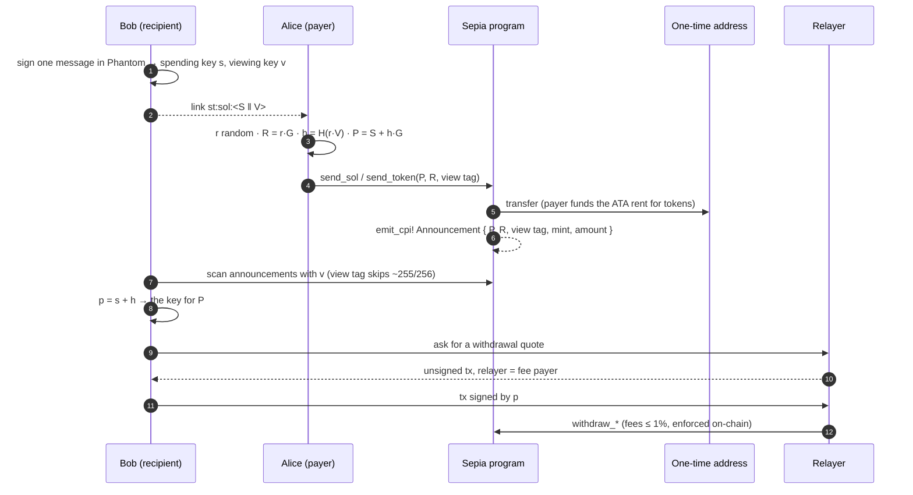
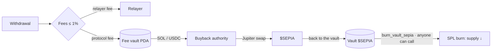

<p align="center">
  
</p>

<p align="center">
  <br>
  <b>Private payments on Solana.</b><br>
  One link. A fresh address for every payment. Zero-SOL withdrawals. Every fee burns <code>$SEPIA</code>.
</p>

<p align="center">
  <a href="https://x.com/sepia_sol">X @sepia_sol</a> ·
  <a href="docs/how-it-works.md">How it works</a> ·
  <a href="docs/architecture.md">Architecture</a> ·
  <a href="docs/privacy-model.md">Privacy model</a> ·
  <a href="ROADMAP.md">Roadmap</a>
</p>

> **Status: Phase 0 — pre-launch.** The program and SDK in this repo are work in progress, unaudited and **not deployed**. Do not send real funds to anything built from this code. The only official `$SEPIA` mint address is the one published on the website and on [@sepia_sol](https://x.com/sepia_sol).

---

## What Sepia does

On Solana, an address is a public ledger page. Share yours once and anyone can open Solscan and read your balance, your history and every wallet you have dealt with.

Sepia lets you **move money unseen**: every payment lands on an address nobody can link to your wallet.

1. You publish one **stealth meta-address** (a link or QR).
2. Every payer derives a **fresh one-time address** from it. Nobody but you can tell that the address is yours.
3. You find your payments with a private **viewing key** and move the funds out through a **relayer** that signs as fee payer, so the one-time address never needs SOL from your main wallet.

The scheme is the dual-key stealth address construction behind Ethereum's [ERC-5564](https://eips.ethereum.org/EIPS/eip-5564) and Monero, rebuilt on **ed25519**. A one-time address is an ordinary Solana account: no new account types, no wrapped balances. Sepia is **not a mixer**: no program pools users' funds, and every payment goes straight to an address that belongs to the recipient.

## How a payment flows



The math in one line: `P = S + H(r·V)·G`, and only the holder of `v` can recompute `r·V = v·R`, while only the holder of `s` can sign for `P` with `p = s + h`. Full walkthrough in [docs/how-it-works.md](docs/how-it-works.md).

## Withdrawals

A one-time address holds no SOL for its own fee. Funding it from your main wallet would link the two. On Solana this is solved natively: **every transaction names its fee payer**, and it does not have to be the account that moves the money.

| Received | How it leaves | Who pays the network fee |
| --- | --- | --- |
| **SOL** | `withdraw_sol`, signed by the one-time key | Relayer (fee payer), repaid from the amount |
| **SPL / Token-2022** | `withdraw_token`, then the one-time ATA is closed | Relayer; the closed ATA's rent goes back to it |

The one-time key signs the **whole transaction message**, so the relayer cannot change the destination, the amount or its own fee after the fact. On top of that the program enforces `protocol fee + relayer fee ≤ 1%`. Details in [docs/withdrawals.md](docs/withdrawals.md).

## Fees and $SEPIA



- The 1% ceiling is a constant in the program, not a config value.
- `$SEPIA` in the fee vault can **only be burned**. `release_tokens_for_buyback` refuses the `$SEPIA` mint.
- `burn_vault_sepia` is permissionless and uses the real SPL `burn` instruction, so total supply on Solscan goes down.
- `$SEPIA` launches on **pump.fun** with a fixed 1B supply and mint authority revoked.
- Holder tiers lower the protocol fee. The tier is read on-chain from the `$SEPIA` balance of the withdrawal's destination wallet ([docs/token.md](docs/token.md)).

## Repository layout

```
programs/sepia/       Anchor program (Rust)
  src/lib.rs          send_sol · send_token · withdraw_sol · withdraw_token · register
                      fee vault, buyback release, permissionless burn, 1% fee ceiling
tests/sepia.ts        program tests on a local validator (anchor test)
sdk/                  TypeScript SDK, zero dependencies beyond @noble/*
  src/keys.ts         spending + viewing keys from one Phantom signature
  src/stealth.ts      one-time address, announcement check, stealth scalar
  src/sign.ts         RFC 8032 signing from a raw scalar (no seed needed)
  src/announcement.ts decode the Announcement event from inner instructions
  src/withdraw.ts     fee quote mirroring the program, withdrawal signing
  test/               11 tests; signatures cross-checked against OpenSSL ed25519
relayer/              relayer HTTP API (OpenAPI) and operating rules
docs/                 protocol, architecture, withdrawals, privacy model, token
deployments/          program and mint addresses per cluster (empty until launch)
```

## Network

| | |
| --- | --- |
| Chain | Solana mainnet-beta |
| Program | `sepia` (Anchor 0.30.1) · address in [deployments/](deployments/) after deploy |
| Token | `$SEPIA`, SPL, 6 decimals, 1,000,000,000 supply, launched on pump.fun |
| Wallets | Phantom, Solflare, Backpack, any Wallet Standard wallet |
| Explorer | [solscan.io](https://solscan.io) |

## Quick start (developers)

```bash
# SDK: no validator needed
cd sdk
npm install
npm test               # 11 tests
npm run example        # Bob publishes, Alice pays, Bob finds and signs a withdrawal

# Program
anchor build
anchor test            # spins up a local validator
```

## Roadmap

| Phase | Name | Ships | Gate |
| --- | --- | --- | --- |
| 0 | Launch | `$SEPIA` on pump.fun, website, link reservation, this repo | Graduated to PumpSwap, mint verified |
| 1 | Private links | Program on mainnet, pay links + Solana Pay QR, SOL & USDC, scanner, relayer, buyback & burn | Security review + first real payments |
| 2 | Cashboxes | Tiers, any SPL token, recurring payments, team cashboxes, auditor keys | External audit published |
| 3 | Network | Relayer staking, open relayer client, SDK + checkout button, ZK research | Independent relayers live |

Full version with deliverables: [ROADMAP.md](ROADMAP.md).

## Security

Unaudited, not deployed. Report vulnerabilities privately as described in [SECURITY.md](SECURITY.md), not in public issues.

## Disclaimer

`$SEPIA` is a community token with no claim on revenue, no ownership rights and no promise of profit. Sepia is not affiliated with pump.fun or the Solana Foundation. Nothing in this repository is financial or legal advice. Privacy tools are subject to local law; use Sepia only where it is legal for you to do so.

## License

[MIT](LICENSE)
